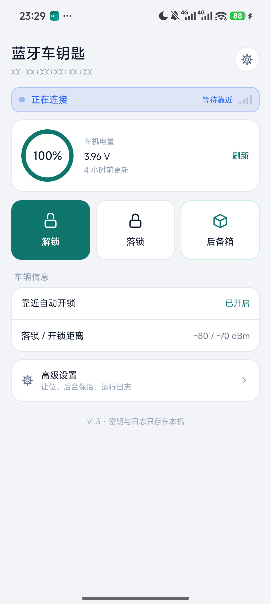
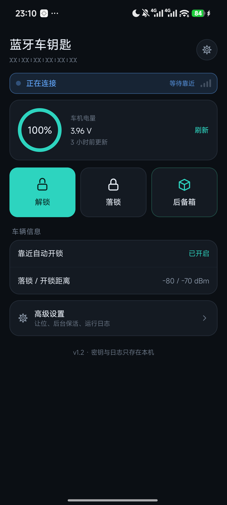

# BleKey · 蓝牙车钥匙

一个只做「靠近车机自动连上 + 一键解锁」的最小 Android 客户端。它不替代原厂 App 的刷固件、改设置等功能，只接管蓝牙连接这一件事。


-3DDC84)


| 浅色主题 | 深色主题 |
| :---: | :---: |
|  |  |

> 截图中出现的设备标识（MAC 地址等）已做脱敏处理。
> 更多界面见 [screenshots/](screenshots/)。

---

## 为什么要重写连接逻辑

原厂 App 的连接链路是「每 10 秒轮询一次直连 + 15 秒超时 + 失败后扫描 20 秒」，且 `autoConnect=false` 必须靠 App 主动发起。叠加 Android 8.1+ 对后台无过滤扫描的限制，实际体验经常是「必须手动打开 App 才连得上」。

| | 原厂 App | BleKey |
| --- | --- | --- |
| 连接方式 | `useAutoConnect(false)` + 轮询直连 | `connectGatt(ctx, true, ...)`，交给控制器白名单自动建连 |
| 依赖扫描 | 需要，后台受限 | 不需要，设备广播一出现即建连 |
| 进程被杀 | 由 ROM 决定 | 前台服务常驻 + 开机自启 + Job/闹钟兜底 |
| 解锁入口 | 手动打开 App | 常驻通知栏按钮，或 RSSI 靠近自动开锁 |
| 联网 | 配对需服务器 | 配对后完全离线，密钥只存本机 |

---

## 功能

- **靠近自动连接**：`autoConnect` 白名单托管给蓝牙控制器，不依赖后台扫描
- **解锁 / 落锁 / 后备箱**：主界面与常驻通知三键均可操作；开锁按车机配置连发 2 帧、间隔 1 秒
- **让位机制**：一键断开 10 分钟，让原厂 App 可以刷固件或改设置，超时自动接管回来
- **舒适进入阈值**：读取并由车机执行距离判断，App 只负责下发阈值与回读校准
- **车机电量 / 电压**：从系统信息同步的 TLV 响应里解析，环形电量 + 电压 + 更新时间
- **运行日志**：每一帧收发的原始 hex 都可在 App 内查看，方便对照协议排查
- **双主题**：跟随系统深色模式，设计令牌集中在 `Ui.java`
- **纯代码 UI**：无布局 XML，界面全部由 Java 绘制，`res/` 只有图标资源

---

## 安装

**推荐从 [Releases](https://github.com/Sjian1988/blekey-android/releases/latest) 下载**，那里是按版本归档的正式产物，附 SHA-256 校验值：

```
https://github.com/Sjian1988/blekey-android/releases/download/v1.4/BleKey-1.4.apk
```

仓库 `release/` 目录同步保留最新一份，方便直接取用：

```bash
adb install -r release/BleKey-1.4.apk
```

也可以把 APK 传到手机上点安装（需允许「安装未知来源」）。包名 `com.blekey.rdb`，与原厂 App 不同，可以共存。

> **签名提示**：`release/` 里的 APK 用调试证书签名，仅用于自测分发。
> 从源码自行构建时会换成你自己的证书，两者签名不同，覆盖安装前需先卸载旧包。
> 仓库中**不包含任何签名私钥**。

### 配对（只需一次）

车机同一时间只认一个绑定的手机，需先在原厂 App 里解绑旧设备，再到 BleKey 中「搜索车机 → 配对」。配对成功后设备密钥存本机 `SharedPreferences`，之后不再需要联网或原厂 App。

BleKey **不提供**「向车机发送解绑」按钮，避免误操作把车机解绑掉。

### 使用要点

1. 保持通知栏那条常驻通知，不要划掉
2. 在系统设置里给 App 加**电池白名单**和**自启动**（Android 12+ 没有白名单会禁止后台启动前台服务，直接导致「靠近连不上」）
3. 最近任务里锁定 App，防止被一键清理
4. 连接状态看顶部胶囊（圆点 + 文字 + 信号条），日志在「高级设置 → 运行日志」

开机自启、前台服务常驻、开锁连发均默认开启，装好即用。

---

## 从源码构建

本工程**不使用 Gradle**，直接调用 `aapt2 / javac / d8 / apksigner`，不需要 Android Studio，也不需要联网拉依赖。

```bash
bash scripts/setup-signing.sh     # 首次：生成本地调试证书（不入库）
bash scripts/build.sh             # 产物：release/BleKey-<versionName>.apk
```

工具链（JDK 17 + Android build-tools 34 + platform 34）需自备，放在仓库根 `sdk/` 目录，或用环境变量指定，详见 [docs/build.md](docs/build.md)。

---

## 目录结构

```
blekey-android/
├── app/src/main/                  Android 标准源码布局
│   ├── java/com/blekey/rdb/       全部 Java 源码（UI 为纯代码绘制）
│   ├── res/                       启动器图标 + 通知栏小图标
│   └── AndroidManifest.xml
├── docs/                         文档（见下方索引）
├── scripts/                      构建脚本：build.sh / setup-signing.sh / add_dex.py
├── tools/                        开发辅助：图标生成、截图放大
├── screenshots/                  界面截图（已脱敏）
├── release/                      预编译 APK
├── .github/                      Issue / PR 模板
├── CHANGELOG.md
├── CONTRIBUTING.md
├── SECURITY.md
├── LICENSE
└── README.md
```

`sdk/`、`build/`、日志与调试产物、签名密钥都在 `.gitignore` 中排除。

---

## 文档

| 文档 | 内容 |
| --- | --- |
| [docs/README.md](docs/README.md) | 文档索引 |
| [docs/protocol.md](docs/protocol.md) | BLE 协议速查：帧格式、TLV、密钥派生、指令表、GATT UUID |
| [docs/build.md](docs/build.md) | 工具链准备、签名、构建流程、目录约定、常见问题 |
| [docs/verification.md](docs/verification.md) | 已验证 / 待验证清单、调试命令、已知限制 |
| [docs/dev-notes.md](docs/dev-notes.md) | 原始开发笔记完整归档（推理过程、踩坑记录，未删改） |

---

## 项目状态

编译、安装、GATT 握手、鉴权、解锁指令全链路已在真机（Android 16 / HyperOS 3）完成验证；部分功能仍待实车确认。完整清单见 [docs/verification.md](docs/verification.md)。

仓库已于 2026-11 转为公开，欢迎 Issue 与 PR。

### 后续计划

- [x] 协议文档与抓包示例完成脱敏复核
- [x] 完成第三方商标 / 名称使用声明后转为公开仓库
- [x] 通过 GitHub Releases 按版本分发（当前 [v1.4](https://github.com/Sjian1988/blekey-android/releases/tag/v1.4)）
- [ ] 补充多车型 / 多车盒固件版本的兼容性说明
- [ ] 补充英文 README 与 Contribution Guide
- [ ] 用正式发布证书替换调试签名

---

## 范围与免责声明

- 本仓库**只包含本人自研的客户端源码、协议层结论（推导记录见 [docs/dev-notes.md](docs/dev-notes.md)）与构建脚本**，不包含任何第三方应用的代码、DEX、APK 等产物，也不包含脱壳、加固绕过一类工具链资料。
- 本项目是面向**本人自有车辆**的互操作性研究，仅用于个人使用。使用者应确保对目标车辆拥有合法所有权或明确授权，并遵守所在地法律法规。
- 解锁、落锁、开启后备箱都是**不可撤销的物理动作**。请在安全环境下使用，因使用本软件产生的任何后果由使用者自行承担。
- 原厂应用名称、协议、商标归各自权利人所有。本项目与其无关联、未获其授权，也不是官方替代品。
- 软件按「现状」提供，不附带任何明示或默示担保，详见 [LICENSE](LICENSE)。

---

## 许可证

[Apache License 2.0](LICENSE) · Copyright 2026 BleKey contributors
